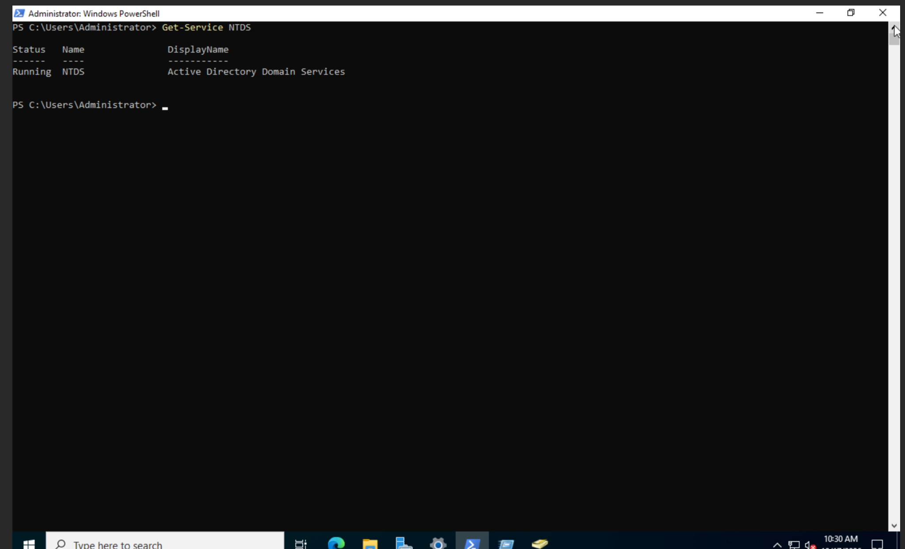
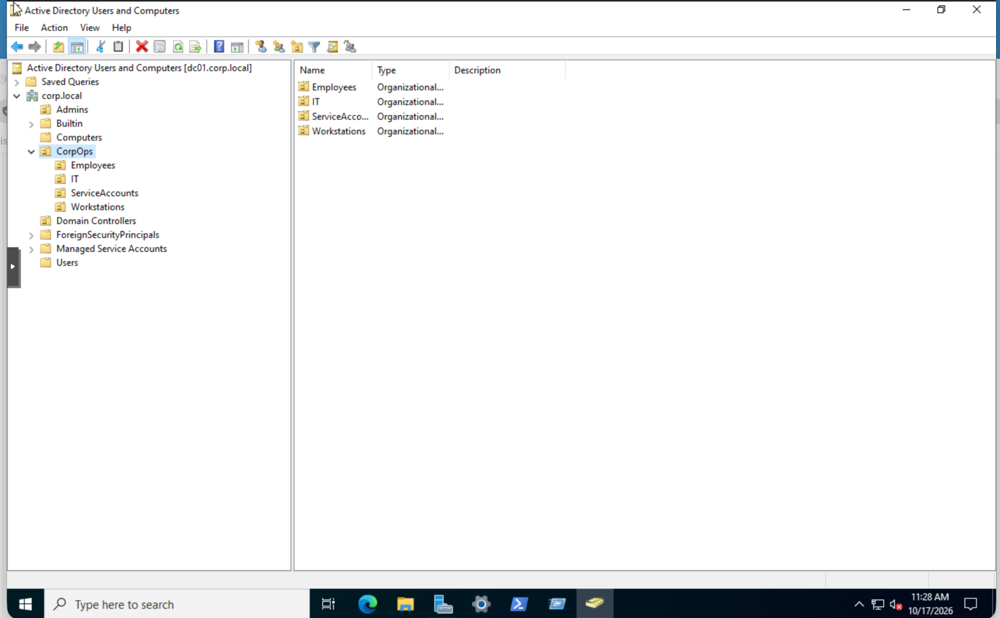
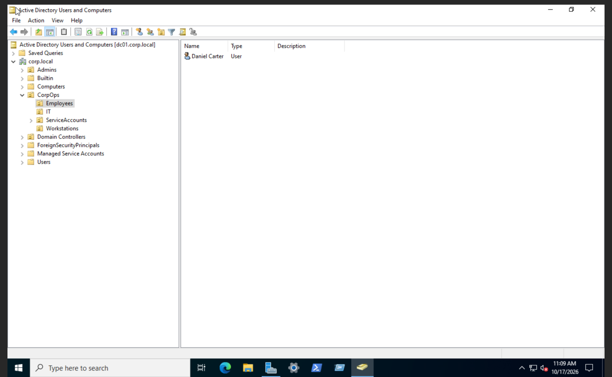
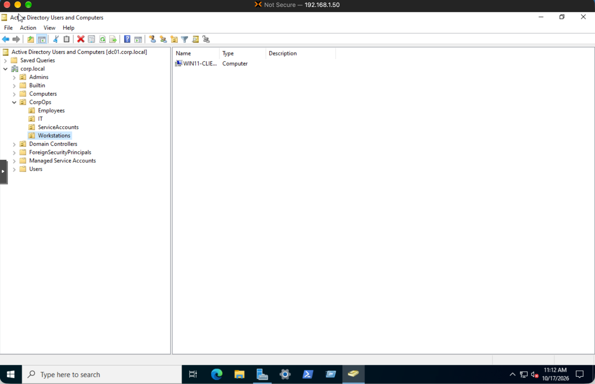

# Day 01 | Active Directory Baseline & Identity Inventory

**Project:** 90 Days of SOC Tier 1 & Tier 2 Mastery  
**Phase:** 01 Active Directory & Help Desk  
**Status:** Hands-on complete  
**Lab domain:** `corp.local`

## Objective

Establish and document the existing Active Directory baseline before making changes to users, groups, computers, or access controls. Identify the domain controller, verify the AD DS service, and inspect existing identity and computer objects.

## Lab Environment

| Component | Configuration |
| --- | --- |
| Hypervisor | Proxmox VE |
| Domain controller | DC01, Windows Server 2022 |
| Domain | `corp.local` |
| AD management tool | Active Directory Users and Computers (ADUC) |
| Client | Windows 11 computer object in the Workstations OU |

## Practical Work Performed

### 1. Domain Controller Verification

Executed the following commands in an administrative PowerShell session:

```powershell
hostname
(Get-CimInstance Win32_ComputerSystem).Domain
Get-Service NTDS
```

**Verified results:**

- Hostname: `dc01`
- Domain: `corp.local`
- NTDS service: `Running`

### 2. Organizational Unit Inventory

Used Active Directory Users and Computers to inspect the existing domain structure.

```text
corp.local
├── Admins                         [Empty]
├── CorpOps
│   ├── Employees                  [Daniel Carter]
│   ├── IT                         [Empty]
│   ├── ServiceAccounts            [Empty]
│   └── Workstations               [Windows 11 computer object]
├── Domain Controllers             [DC01]
├── Computers                      [Empty]
└── Users                          [Default accounts and groups]
```

This is a simplified inventory of the containers inspected, not an exhaustive representation of every default Active Directory container.

### 3. Identity and Computer Inventory

- Identified an existing employee account, Daniel Carter, in the Employees OU.
- Confirmed the IT, ServiceAccounts, and Admins OUs were empty at the time of inspection.
- Located a Windows 11 computer object under Workstations.
- Located DC01 in the Domain Controllers OU, displayed as a global catalog.
- Inspected the default Users container and identified built-in accounts and security groups.
- Confirmed the default Computers container was empty.

## Evidence

All screenshots below were collected from my actual Active Directory home lab during Day 01.

### Evidence 01: Active Directory Domain Services



**Observation:** The NTDS service was running on DC01, confirming that the Active Directory Domain Services service was active at the time of verification.

### Evidence 02: Organizational Unit Structure



**Observation:** Inspected the existing `corp.local` organizational structure, including the CorpOps departmental OUs.

### Evidence 03: Employee Account Inventory



**Observation:** Identified an existing employee account in the CorpOps Employees OU.

### Evidence 04: Workstation Computer Account



**Observation:** Located the Windows client computer account in the CorpOps Workstations OU.

## SOC Analyst Relevance

An Active Directory baseline helps a SOC analyst understand which accounts, groups, organizational units, and computer objects exist before investigating suspicious identity changes.

This context supports investigations involving:

- Unexpected account creation or modification
- Unauthorized security group membership changes
- Suspicious computer account activity
- Privilege escalation involving Active Directory identities
- Changes that deviate from the established environment baseline

These are potential investigation use cases, not incidents detected during Day 01.

## Observations and Limitations

**Observed:** The NTDS service was running, the domain was identified as `corp.local`, and the listed Active Directory objects were visible in ADUC.

**Not yet verified:** Complete security group memberships, successful authentication for every account, DNS health, Group Policy application, and end-to-end domain connectivity.

These areas require separate validation during subsequent exercises.

## Outcome

Completed the initial Active Directory baseline and identity inventory without modifying existing domain objects.

The documented findings establish a reference for future identity administration, Help Desk troubleshooting, and SOC security investigations.

## Next Exercise

**Day 02 — Identity Inventory**

Continue the approved Active Directory learning plan, building on the Day 01 baseline without repeating completed checks.
  
