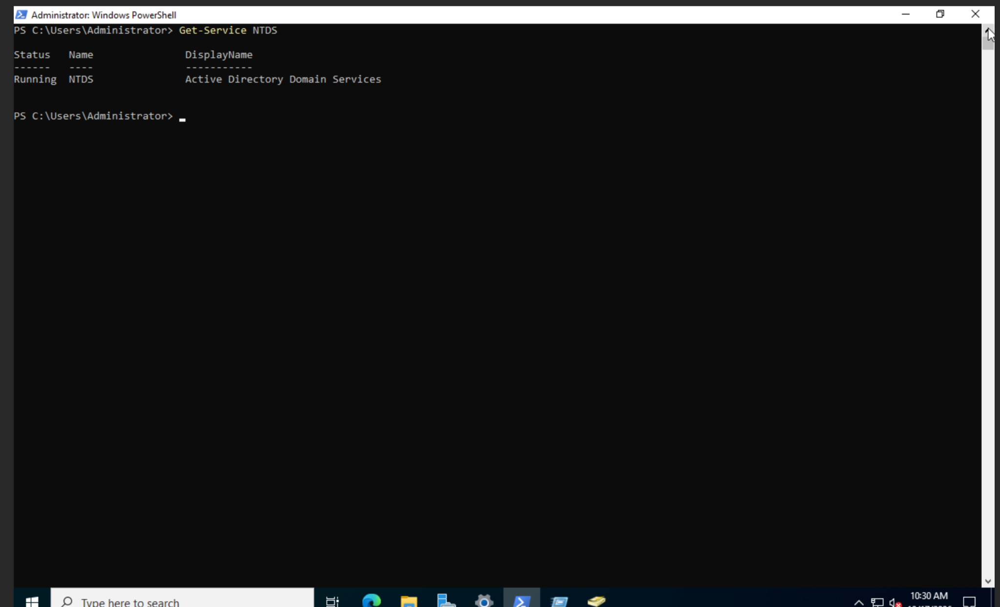
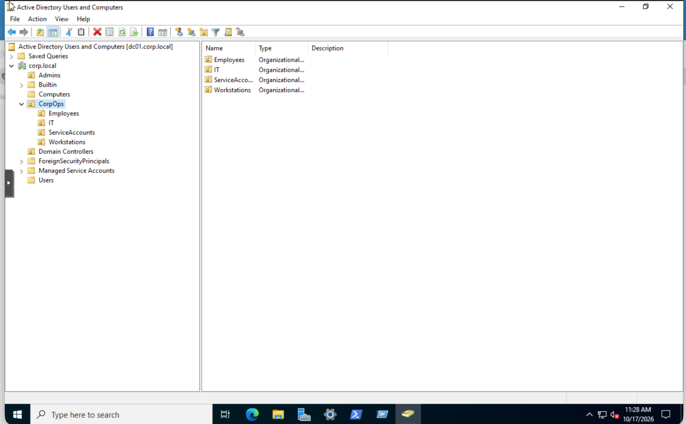
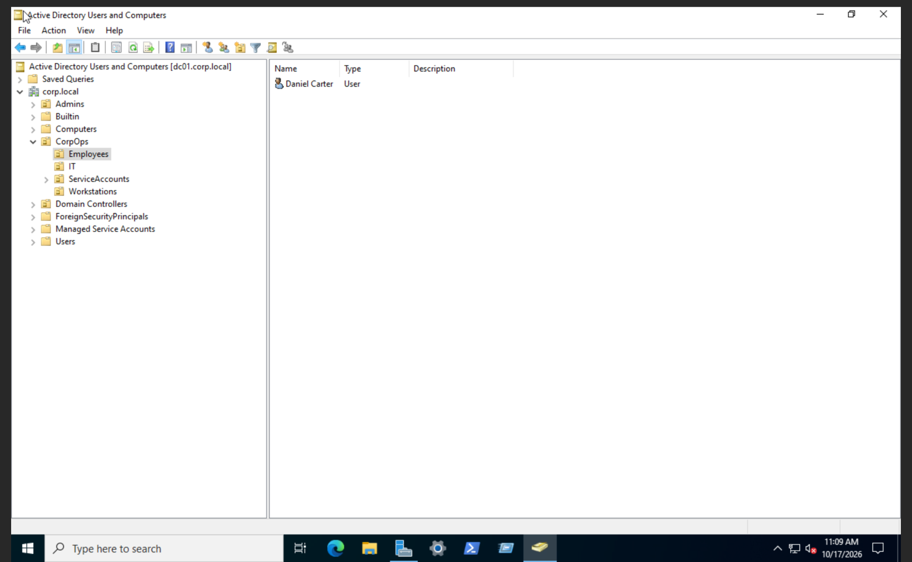
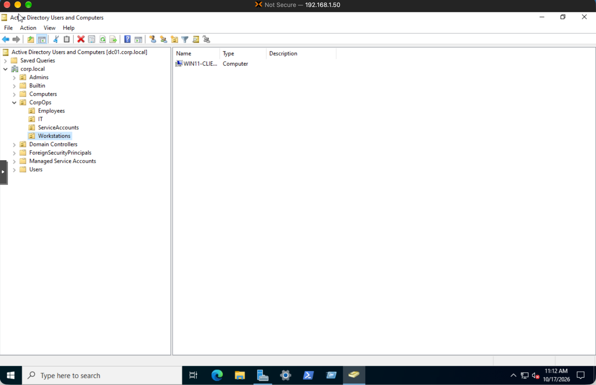

# Day 01 | Active Directory Baseline and Investigation Notes

## Master Station Log

| Field | Details |
| --- | --- |
| Case ID | SOC-AD-001 |
| Exercise | Active Directory Baseline and Identity Inventory |
| Date | 2026-11-03 |
| Environment | Proxmox VE, Windows Server 2022, Windows 11 |
| Domain Controller | DC01 |
| Domain | corp.local |
| Activity Type | Baseline verification and identity inventory |
| Status | Completed |
| Disposition | Baseline documented. No security incident assessed. |

## 1. Initial Objective

Establish a reliable Active Directory baseline before performing identity administration, access management, or security investigations.

This exercise was a planned inventory activity, not a response to a security alert.

## 2. Systems and Evidence Sources

- DC01 running Windows Server 2022
- Active Directory Users and Computers (ADUC)
- Administrative Windows PowerShell
- Existing Active Directory organizational units and objects
- Genuine screenshots captured during the exercise

## 3. Actions and Verified Results

| Action | Verified Result |
| --- | --- |
| Execute `hostname` | dc01 |
| Query computer domain | corp.local |
| Execute `Get-Service NTDS` | Running |
| Inspect Admins OU | Empty |
| Inspect CorpOps Employees OU | Daniel Carter account present |
| Inspect CorpOps IT OU | Empty |
| Inspect CorpOps ServiceAccounts OU | Empty |
| Inspect CorpOps Workstations OU | Windows client computer object present |
| Inspect Domain Controllers OU | DC01 present, displayed as GC |
| Inspect default Computers container | Empty |
| Inspect default Users container | Built-in accounts and security groups visible |

These findings represent the environment at the time of inspection.

## 4. Evidence References

### Evidence 01: Active Directory Domain Services

**Observed:** The NTDS service reported a Running status.

**Interpretation:** The Active Directory Domain Services service was active at the time of verification.

### Evidence 02: Organizational Unit Structure

**Observed:** The existing domain organizational structure was accessible through ADUC.

**Interpretation:** The identified organizational units provide a starting reference for future identity administration and investigations.

### Evidence 03: Employee Account Inventory

**Observed:** An existing employee identity was present in the Employees OU.

**Interpretation:** This account forms part of the initial identity inventory.

### Evidence 04: Workstation Computer Account

**Observed:** A Windows client computer object was present in the Workstations OU.

**Interpretation:** The object provides a reference for subsequent computer account and domain membership investigations.

## 5. Analyst Assessment

### Observed

- The domain controller identified itself as dc01.
- The computer reported membership in corp.local.
- Active Directory Domain Services was running.
- Existing user and computer objects were visible in ADUC.
- Several organizational units contained no objects at the time of inspection.

### Correlated

PowerShell verification and ADUC inspection provided complementary evidence of the domain controller configuration and accessible directory structure.

The service status and directory inventory were consistent with the presence of an operational Active Directory management environment.

### Interpretation

The collected information establishes an initial identity and computer inventory for future comparison.

An empty organizational unit is an inventory observation. It does not automatically indicate a security failure or misconfiguration.

### Unknown

The following areas were not fully validated during Day 01:

- Complete security group memberships
- End-to-end DNS functionality
- Authentication success for all identities
- Group Policy application
- Full domain connectivity
- Active Directory replication health, if applicable

These areas require separate verification before conclusions can be made.

## 6. Actions and Changes

This was a read-only baseline exercise.

No new user accounts, security groups, organizational units, or computer objects were created as part of Day 01.

No remediation or detection tuning was performed.

## 7. Classification and Disposition

**Classification:** Planned Active Directory baseline activity.

**Disposition:** Inventory completed and documented.

**Security Conclusion:** No incident determination was required because this exercise was not triggered by a security alert.

The absence of an identified incident during this exercise does not establish that the environment is free from threats.

## 8. Verification and Evidence Gaps

The collected screenshots support the documented service and directory observations.

Additional validation is required for:

- Authentication behavior
- DNS functionality
- Security group membership
- Group Policy application
- Access permissions
- Domain connectivity

These items remain outside the completed Day 01 scope.

## 9. Handover Notes

The next analyst should use this baseline when investigating identity changes or continuing the approved Active Directory exercises.

The documented observations provide a reference for identifying changes in accounts, organizational units, security groups, and computer objects.

Previously completed Day 01 checks should not be repeated unless a new investigation, configuration change, or troubleshooting requirement makes revalidation necessary.

## 10. Next Action

Proceed to Day 02 under the approved 90 Days of SOC Tier 1 and Tier 2 Mastery roadmap.

Use the documented Day 01 findings as the starting reference.

## Documentation Principle

Record what was observed, distinguish interpretation from evidence, identify unknowns, and leave enough information for another analyst to continue the work.

