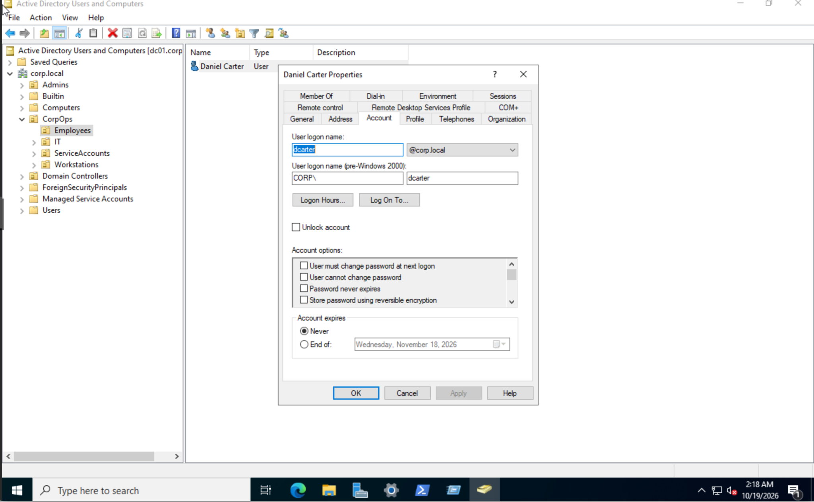
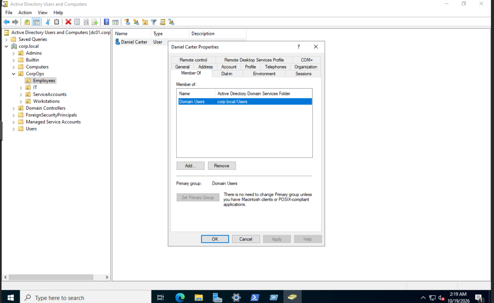
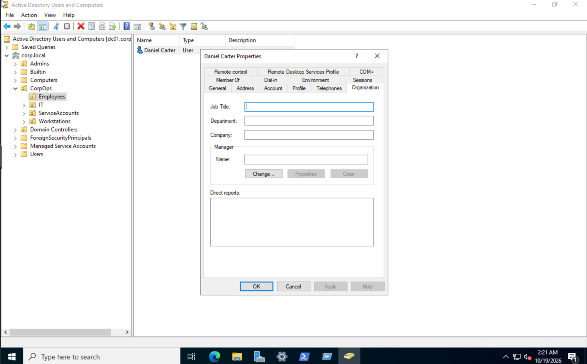
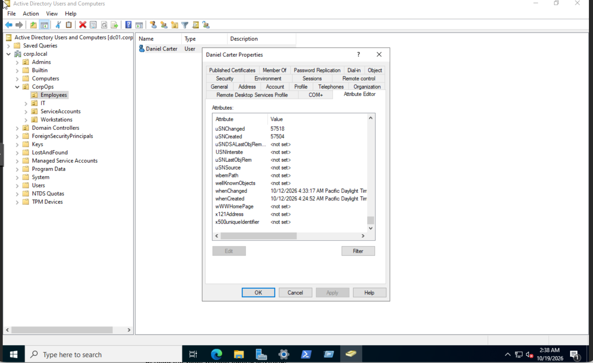
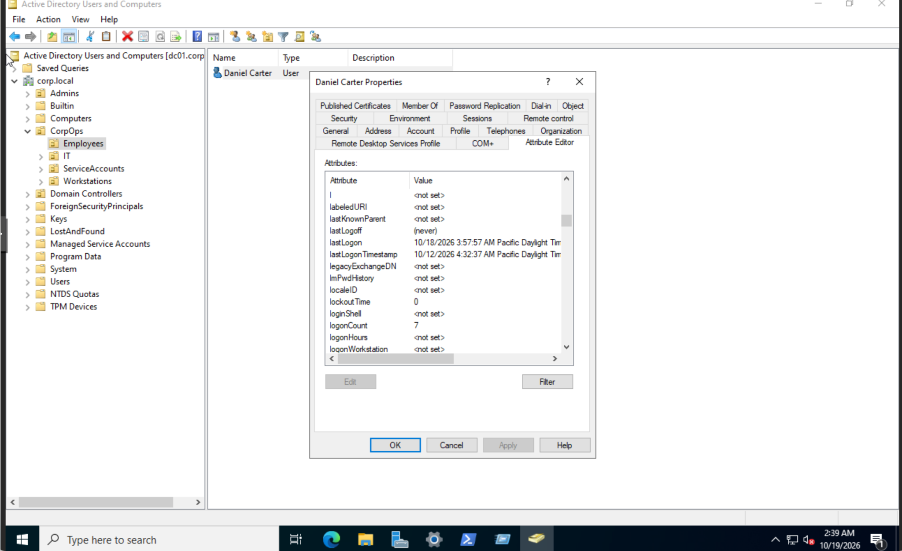
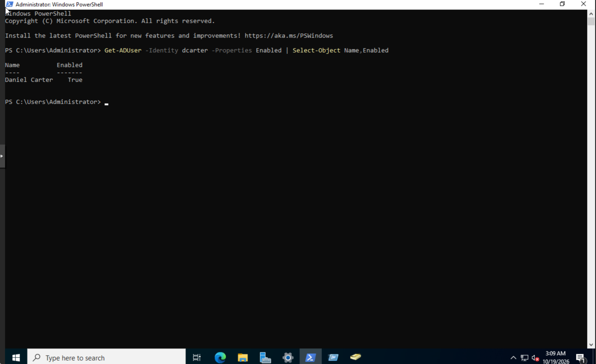

# Day 02 | Active Directory Identity Inventory

**Project:** 90 Days of SOC Tier 1 & Tier 2 Mastery  
**Phase:** 01 | Active Directory & Help Desk  
**Status:** Hands-on complete  
**Lab Domain:** `corp.local`  
**Investigation Date:** November 4, 2026

## Objective

Inspect an existing Active Directory identity to establish a baseline of account configuration, group membership, organizational information, directory timestamps, and recorded logon attributes.

The objective was to distinguish verified account properties from assumptions about authentication behavior and security risk.

## Lab Environment

| Component | Configuration |
|---|---|
| Hypervisor | Proxmox VE |
| Domain Controller | DC01 |
| Operating System | Windows Server 2022 |
| Domain | `corp.local` |
| Identity Management | Active Directory Users and Computers |
| Command Line | Windows PowerShell |
| Account Investigated | Daniel Carter |
| Username | `dcarter` |
| Organizational Unit | `CorpOps/Employees` |

## Investigation Methodology

The investigation followed a read-only workflow:

1. Identify the existing account.
2. Inspect account configuration.
3. Review direct group membership.
4. Examine organizational attributes.
5. Review account creation and modification timestamps.
6. Examine recorded logon and lockout attributes.
7. Verify account status using PowerShell.
8. Interpret the findings and document evidence limitations.

No account settings were intentionally modified.

## 1. Account Identity and Configuration

The existing account was located under:

`corp.local > CorpOps > Employees`

The following attributes were verified:

| Attribute | Finding |
|---|---|
| Display Name | Daniel Carter |
| User Principal Name | `dcarter@corp.local` |
| Legacy Logon Name | `CORP\dcarter` |
| Account Expiration | Never |
| Must Change Password at Next Logon | Unchecked |
| User Cannot Change Password | Unchecked |
| Password Never Expires | Unchecked |
| Reversible Password Encryption | Unchecked |

The visible settings did not establish any immediate password configuration exception.

Account expiration and password expiration were treated as separate controls.

## 2. Security Group Membership

The Member Of tab showed:

| Attribute | Finding |
|---|---|
| Direct Membership | Domain Users |
| Primary Group | Domain Users |
| Additional Direct Groups | None displayed |
| Privileged Direct Membership | None observed |

No direct privileged group membership was identified.

This does not establish the account's complete effective access because nested groups, delegated permissions, and resource-specific access controls were not evaluated.

## 3. Organizational Attributes

The Organization tab showed:

| Attribute | Finding |
|---|---|
| Job Title | Blank |
| Department | Blank |
| Company | Blank |
| Manager | Not assigned |
| Direct Reports | None displayed |

### Interpretation

The missing organizational attributes represent an identity documentation gap.

These fields can support account ownership verification, access reviews, and security investigations.

No policy violation was established because an approved identity documentation standard or authoritative HR record was not reviewed.

## 4. Directory Metadata

The Attribute Editor exposed the following information:

| Attribute | Recorded Value |
|---|---|
| `whenCreated` | October 12, 2026, 4:24:52 AM |
| `whenChanged` | October 12, 2026, 4:33:17 AM |
| `uSNCreated` | 57504 |
| `uSNChanged` | 57518 |

The displayed timestamps used Pacific Daylight Time.

The object was modified approximately eight minutes after creation.

The available evidence does not identify the person responsible for the modification, the exact attributes changed, or whether the change was authorized.

## 5. Authentication and Lockout Attributes

| Attribute | Recorded Value |
|---|---|
| `lastLogon` | October 18, 2026, 3:57:57 AM |
| `lastLogonTimestamp` | October 12, 2026, 4:32:37 AM |
| `logonCount` | 7 |
| `lockoutTime` | 0 |
| `badPwdCount` | 0 |
| `lastLogoff` | Never |

The recorded timestamps were displayed in Pacific Daylight Time.

### Interpretation

The difference between `lastLogon` and `lastLogonTimestamp` is not automatically suspicious.

`lastLogon` is maintained independently by domain controllers, while `lastLogonTimestamp` is replicated and designed to provide an approximate indication of recent logon activity.

The `logonCount` value is not a complete authentication event history.

The reviewed attributes alone cannot establish the source workstation, logon type, or authorization of individual authentication events.

## 6. Account Status Verification

The account status was verified using Windows PowerShell on DC01.

```powershell
Get-ADUser -Identity dcarter -Properties Enabled | Select-Object Name,Enabled
```

### Observed Output

```text
Name           Enabled
----           -------
Daniel Carter  True
```

**Result:** The account was enabled at the time of verification.

## 7. SOC Analyst Reasoning Exercise

A hypothetical authentication scenario was used to practice evidence-based decision-making.

The scenario involved seven successful logons, no identified failed logons, a consistent corporate workstation, and normal working hours.

The exercise highlighted that successful authentication does not automatically establish authorized activity.

A defensible disposition requires correlation with the expected account owner, source workstation, timing, and available authentication evidence.

**Evidence limitation:** No corresponding Windows Security Event ID 4624 or 4625 records were retrieved or validated during this Day 02 exercise. The scenario is not presented as an actual security incident.

## 8. Findings and Disposition

| Finding | Assessment |
|---|---|
| Account identity | Verified |
| Account enabled | Verified |
| Direct group membership | Domain Users only |
| Organizational information | Incomplete |
| Account timestamps | Recorded |
| Authentication attributes | Recorded |
| Unauthorized activity | Not established |
| Account modifications | None intentionally performed |

### Final Disposition

**Identity baseline established.**

No suspicious activity was demonstrated by the reviewed Active Directory attributes.

The missing organizational information remains a documentation gap requiring comparison against an approved identity standard.

No security incident was confirmed.

## 9. Evidence

The following screenshots support the verified findings. Images will render after the corresponding files have been uploaded to the `evidence` directory.

### Evidence 01: Account Configuration



### Evidence 02: Security Group Membership



### Evidence 03: Organizational Attributes



### Evidence 04: Account Creation and Modification Timestamps



### Evidence 05: Authentication and Lockout Attributes



### Evidence 06: Account Enabled Verification



## 10. Lessons Learned

1. Account inventory should establish a verified baseline before security conclusions are made.
2. Direct group membership does not represent complete effective access.
3. Missing identity attributes can complicate investigations without automatically indicating a security incident.
4. Directory timestamps require context and supporting audit evidence.
5. Successful authentication does not automatically prove authorized activity.
6. Investigation documentation must distinguish observed evidence, interpretation, and unresolved questions.

## Conclusion

Day 02 established a documented identity baseline for an existing Active Directory user account.

The exercise reinforced the importance of interpreting account attributes carefully, validating account status independently, and avoiding unsupported security classifications.

The findings provide a reference point for later Active Directory administration, Help Desk troubleshooting, and SOC investigations.
