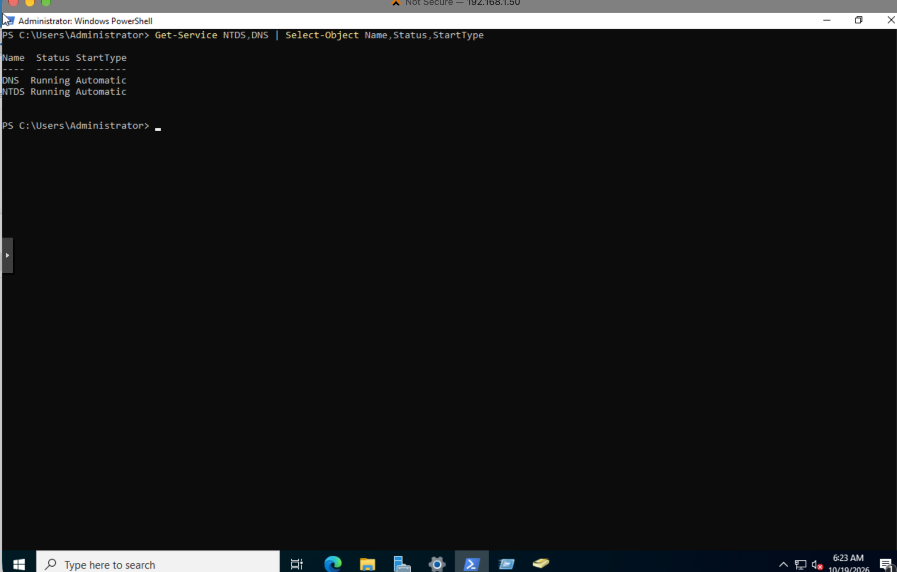
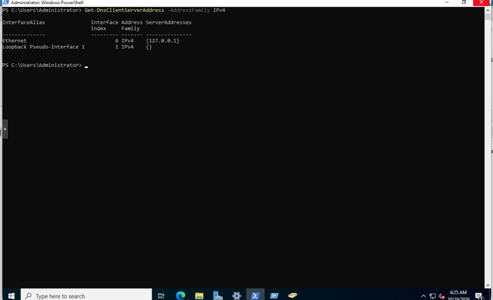
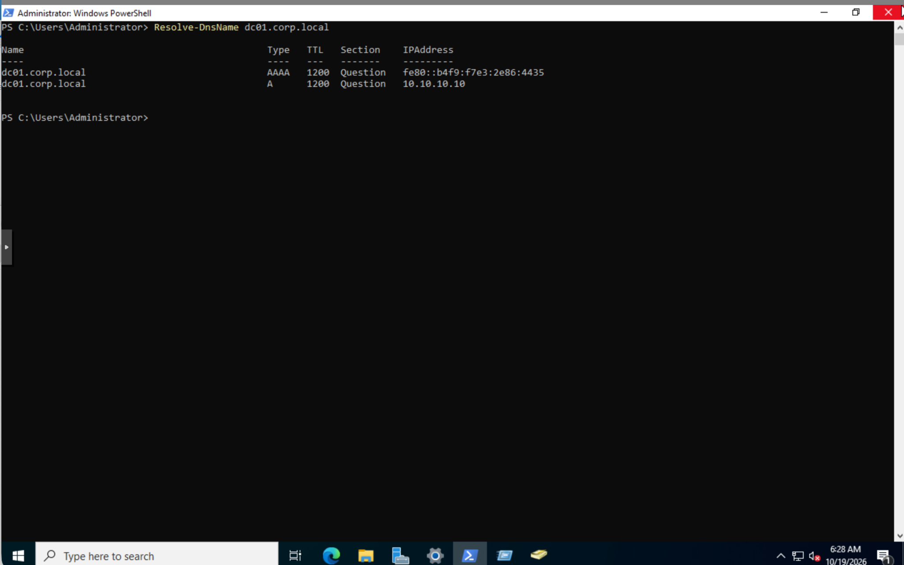
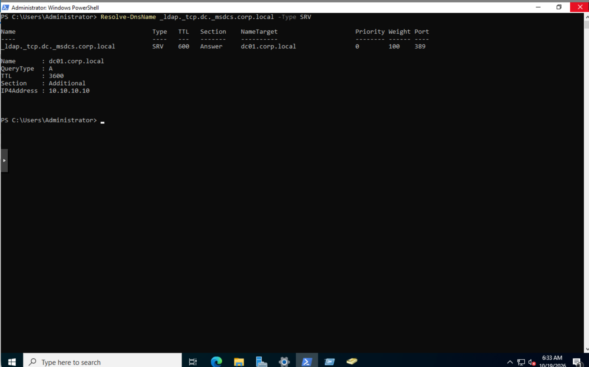
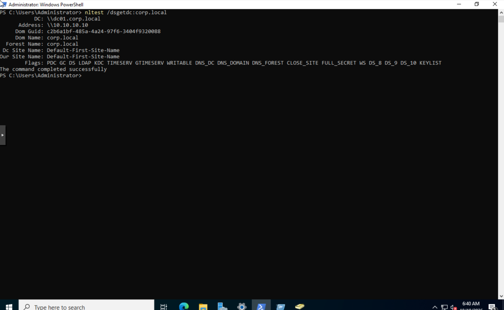
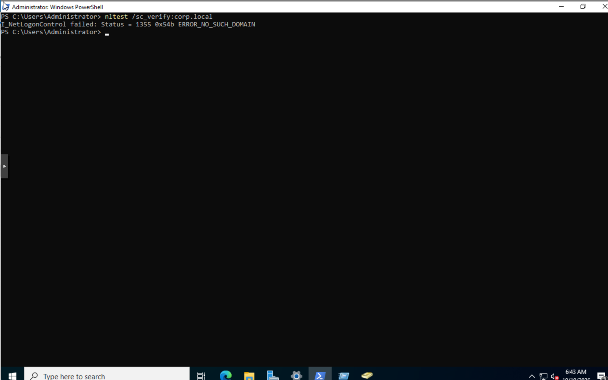
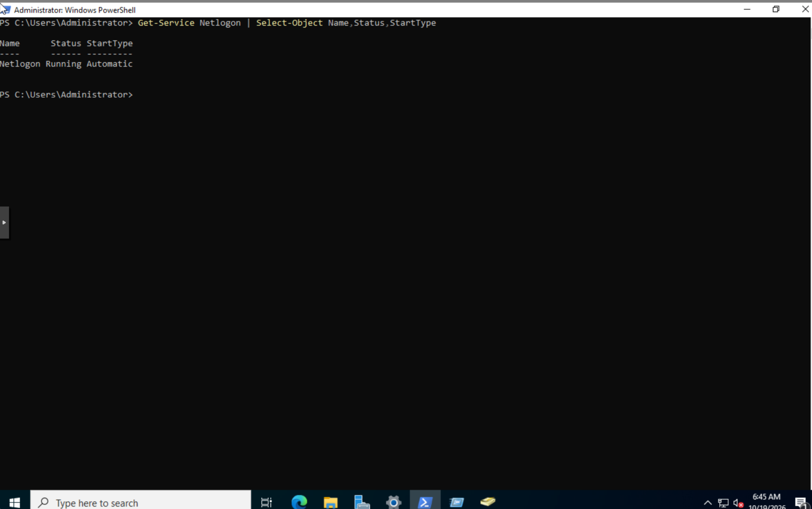
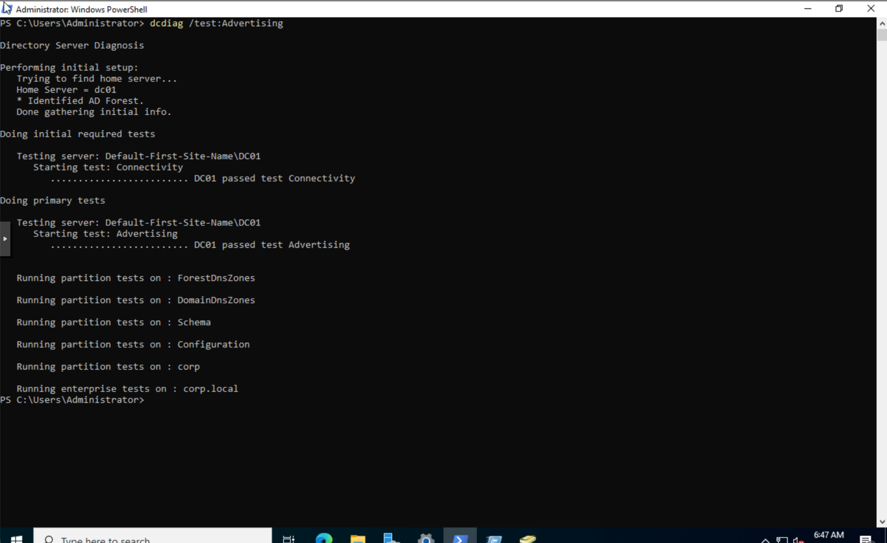
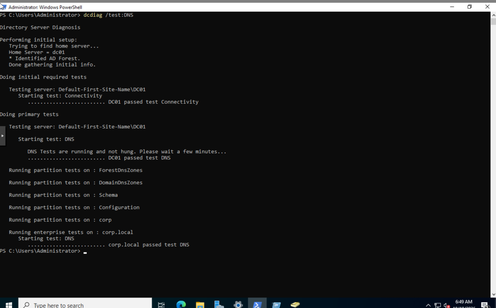
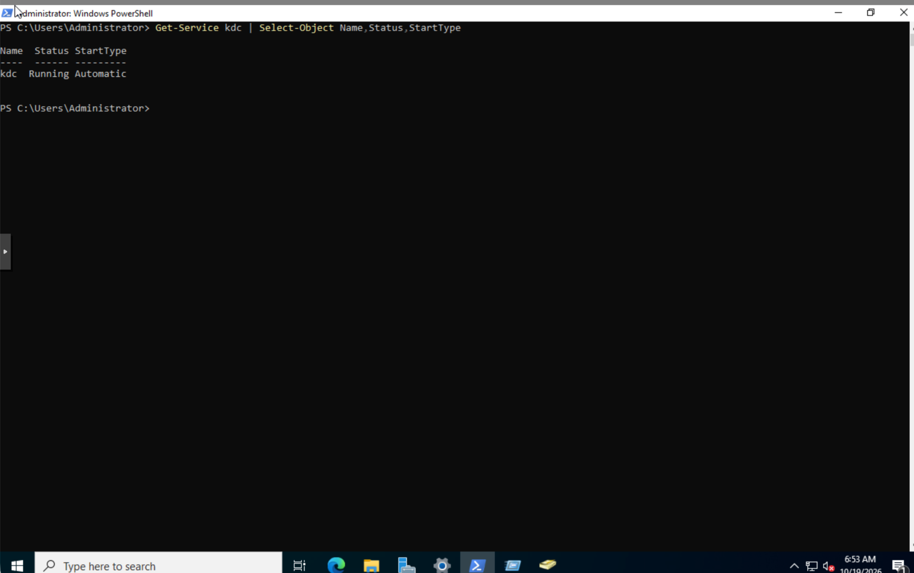

# Day 03 | Active Directory Domain Services and DNS Verification

**Project:** 90 Days of SOC Tier 1 & Tier 2 Mastery  
**Phase:** 01 | Active Directory & Help Desk  
**Status:** Hands-on verification completed  
**Lab Domain:** `corp.local`  
**Investigation Date:** November 5, 2026

## Objective

Verify the core services and DNS records supporting the `corp.local` Active Directory environment.

The exercise focused on checking whether DC01 was running the required services, resolving its hostname, publishing domain controller discovery records, and passing targeted domain controller diagnostics.

An unexpected secure-channel verification error was also documented and investigated without making unnecessary configuration changes.

## Lab Environment

| Component | Configuration |
|---|---|
| Hypervisor | Proxmox VE |
| Domain Controller | DC01 |
| Operating System | Windows Server 2022 |
| Domain | `corp.local` |
| Domain Controller FQDN | `dc01.corp.local` |
| Domain Controller IPv4 | `10.10.10.10` |
| Investigation Tool | Windows PowerShell |
| Diagnostic Tools | `nltest`, `dcdiag` |

All commands in this exercise were executed on DC01.

## 1. Investigation Methodology

The investigation followed a read-only verification workflow:

1. Check Active Directory and DNS service status.
2. Review the domain controller's DNS client configuration.
3. Verify hostname resolution.
4. Verify the LDAP DNS SRV record.
5. Test domain controller discovery.
6. Attempt secure-channel verification.
7. Investigate the unexpected result through service checks and diagnostics.
8. Verify the Kerberos KDC service.
9. Document findings, limitations, and disposition.

No services were intentionally restarted and no DNS or Active Directory settings were modified.

## 2. Active Directory and DNS Service Verification

The first check examined the DNS Server and Active Directory Domain Services services.

```powershell
Get-Service NTDS,DNS | Select-Object Name,Status,StartType
```

### Observed Results

| Service | Status | Startup Type |
|---|---|---|
| DNS | Running | Automatic |
| NTDS | Running | Automatic |

### Interpretation

Both services were running and configured to start automatically.

This confirmed their service-level status but did not independently establish complete DNS or authentication functionality.



## 3. DNS Client Configuration

The next check examined the DNS servers configured on DC01.

```powershell
Get-DnsClientServerAddress -AddressFamily IPv4
```

### Observed Results

| Interface | Configured DNS Server |
|---|---|
| Ethernet | `127.0.0.1` |
| Loopback Pseudo-Interface 1 | No server listed |

### Interpretation

The Ethernet interface was configured to use the local DNS service through the loopback address `127.0.0.1`.

This is a valid configuration for a domain controller hosting DNS.

The result established the configured DNS destination, not whether every DNS query would succeed.



## 4. Domain Controller Hostname Resolution

The following command tested forward DNS resolution:

```powershell
Resolve-DnsName dc01.corp.local
```

### Observed Results

| Record | Returned Address |
|---|---|
| A | `10.10.10.10` |
| AAAA | `fe80::b4f9:f7e3:2e86:4435` |

The A record matched the expected IPv4 address of DC01.

The AAAA result contained an IPv6 link-local address.

### Interpretation

The DNS resolver returned the expected IPv4 record for `dc01.corp.local`.

This supported successful hostname resolution from DC01.

It did not independently prove that remote clients could reach the domain controller.



## 5. LDAP SRV Record Verification

Active Directory clients use DNS SRV records to locate domain controllers offering directory services.

The following command was executed:

```powershell
Resolve-DnsName _ldap._tcp.dc._msdcs.corp.local -Type SRV
```

### Observed Results

| Attribute | Value |
|---|---|
| SRV Record | `_ldap._tcp.dc._msdcs.corp.local` |
| Target | `dc01.corp.local` |
| Port | 389 |
| Priority | 0 |
| Weight | 100 |
| Target IPv4 | `10.10.10.10` |

### Interpretation

The LDAP SRV record existed and pointed to the expected domain controller.

This supported DNS-based domain controller discovery.

A valid SRV record does not independently prove that an LDAP authentication operation succeeds.



## 6. Domain Controller Discovery

The next test used Windows domain controller discovery.

```powershell
nltest /dsgetdc:corp.local
```

### Observed Results

| Attribute | Value |
|---|---|
| Domain Controller | `dc01.corp.local` |
| Address | `10.10.10.10` |
| Domain | `corp.local` |
| Forest | `corp.local` |
| Site | `Default-First-Site-Name` |
| Command Result | Completed successfully |

The returned capability flags included:

- PDC
- GC
- DS
- LDAP
- KDC
- TIMESERV
- WRITABLE
- DNS_DC
- DNS_DOMAIN
- DNS_FOREST

### Interpretation

Windows successfully discovered DC01 and returned its advertised domain controller capabilities.

The result supported successful domain controller discovery.

The capability flags were not treated as independent proof that every advertised service could complete an authentication request.



## 7. Unexpected Secure-Channel Verification Error

The following command was executed on DC01:

```powershell
nltest /sc_verify:corp.local
```

### Actual Result

```text
I_NetLogonControl failed: Status = 1355 0x54b ERROR_NO_SUCH_DOMAIN
```

The command did not succeed.

### Initial Interpretation

This result required further investigation.

The command was executed on a domain controller rather than a domain-joined member workstation.

Therefore, the error was not treated as conclusive evidence of a broken workstation trust relationship or a failed Active Directory domain.

Earlier DNS resolution and domain controller discovery tests had succeeded.

The next checks focused on collecting additional evidence rather than changing configuration.



## 8. Netlogon Service Verification

The Netlogon service was checked using:

```powershell
Get-Service Netlogon | Select-Object Name,Status,StartType
```

### Observed Result

| Service | Status | Startup Type |
|---|---|---|
| Netlogon | Running | Automatic |

### Interpretation

Netlogon was running and configured to start automatically.

This ruled out a stopped Netlogon service as an explanation at the time of inspection.

It did not identify the precise cause of error 1355.



## 9. Domain Controller Advertising Diagnostics

The following diagnostic command was executed:

```powershell
dcdiag /test:Advertising
```

### Observed Results

```text
DC01 passed test Connectivity
DC01 passed test Advertising
```

### Interpretation

DC01 passed the Connectivity and Advertising diagnostics.

These results provided additional evidence that the domain controller could be located and was advertising its expected roles.

They did not independently resolve the earlier secure-channel error.



## 10. DNS Diagnostics

The next diagnostic command was:

```powershell
dcdiag /test:DNS
```

### Observed Results

```text
DC01 passed test Connectivity
DC01 passed test DNS
corp.local passed test DNS
```

### Interpretation

The displayed DNS diagnostics passed for DC01 and the domain.

This strengthened the evidence that DNS functionality was operating correctly within the scope of the tests performed.

The successful diagnostics did not establish that every possible DNS configuration or client authentication scenario had been tested.



## 11. Kerberos KDC Service Verification

The final service check examined the Kerberos Key Distribution Center.

```powershell
Get-Service Kdc | Select-Object Name,Status,StartType
```

### Observed Result

| Service | Status | Startup Type |
|---|---|---|
| KDC | Running | Automatic |

### Interpretation

The Kerberos KDC service was running and configured to start automatically.

This supported the domain controller service baseline.

A running KDC service does not independently establish successful Kerberos ticket issuance or user authentication.



## 12. Findings Summary

| Verification | Result |
|---|---|
| DNS Server service | Running |
| Active Directory Domain Services | Running |
| DNS client configuration | Local DNS configured |
| DC01 hostname resolution | Expected IPv4 returned |
| LDAP SRV record | Expected target returned |
| Domain controller discovery | Successful |
| Secure-channel verification on DC01 | Failed with error 1355 |
| Netlogon service | Running |
| Connectivity diagnostic | Passed |
| Advertising diagnostic | Passed |
| DNS diagnostics | Passed |
| KDC service | Running |

## 13. SOC Analyst Reasoning

This exercise demonstrated why one failed command should not automatically determine the overall assessment of a system.

The secure-channel verification returned an error.

Instead of assuming the domain was broken, additional checks were performed.

Those checks established that:

1. Netlogon was running.
2. DC01 passed its Advertising diagnostic.
3. DC01 passed its Connectivity diagnostic.
4. DNS diagnostics passed.
5. The KDC service was running.

The evidence supported the operation of the tested domain services while leaving the precise reason for the secure-channel command failure unresolved.

This distinction is important in SOC investigations and IT troubleshooting.

An analyst must distinguish a failed test from a confirmed system failure.

## 14. Evidence Gaps and Limitations

The following were not established during Day 03:

- The precise cause of `ERROR_NO_SUCH_DOMAIN` from the secure-channel command on DC01.
- A secure-channel verification result from the Windows 11 member workstation.
- Successful end-to-end user authentication.
- Successful Kerberos ticket issuance.
- Full Group Policy processing.
- Complete Active Directory replication health.
- DNS resolution and connectivity from every client.

These limitations are recorded for future exercises.

## 15. Final Disposition

**Classification:** Planned Active Directory and DNS verification

**Verified Outcome:** Core services, DNS resolution, domain controller discovery, and targeted diagnostics passed.

**Outstanding Finding:** Secure-channel verification on DC01 returned error 1355. Its cause was not established.

**Configuration Changes:** None intentionally performed.

**Security Incident:** Not established.

### Conclusion

Day 03 established an evidence-based operational baseline for the tested Active Directory and DNS components.

The exercise also provided a practical troubleshooting lesson: unexpected command output must be interpreted alongside independent evidence and the context in which the test was executed.

The secure-channel error remains documented rather than being incorrectly classified as resolved.

## 16. Lessons Learned

1. A running service does not prove complete application functionality.
2. DNS hostname records and SRV records provide different forms of verification.
3. Domain controller discovery depends on more than the presence of a single DNS record.
4. Diagnostic results should be interpreted according to the exact tests performed.
5. A failed command is an observation, not automatically a confirmed root cause.
6. Troubleshooting should collect evidence before changing a working configuration.
7. Accurate documentation must preserve both successful checks and unresolved failures.

## 17. Next Exercise

Day 04 continues the Active Directory and DNS functionality phase.

Future verification will build on this baseline without repeating completed checks unnecessarily.

## References

- Microsoft Learn: DCDiag
  https://learn.microsoft.com/en-us/windows-server/administration/windows-commands/dcdiag

- Microsoft Learn: Verify DNS Functionality to Support Directory Replication
  https://learn.microsoft.com/en-us/windows-server/identity/ad-ds/manage/troubleshoot/verify-dns-functionality-to-support-directory-replication
