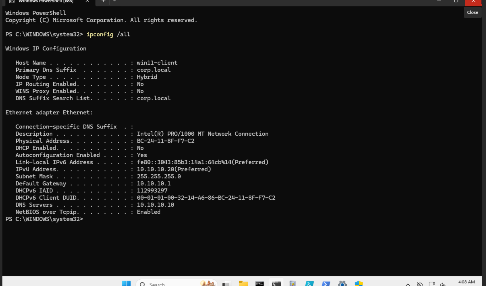
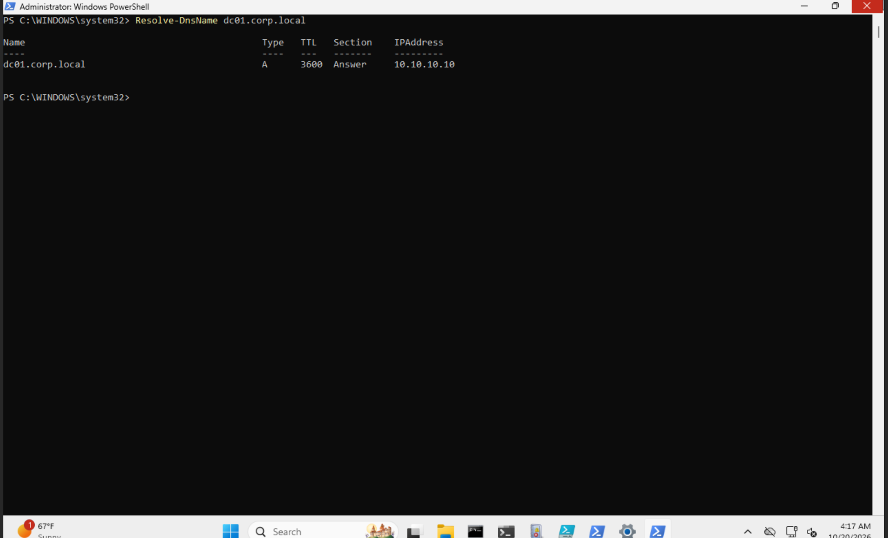
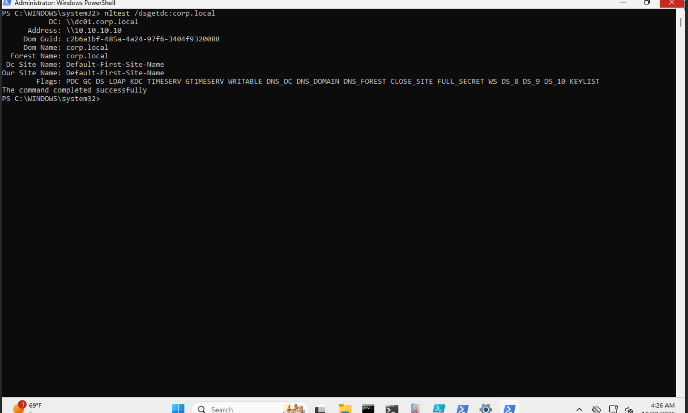
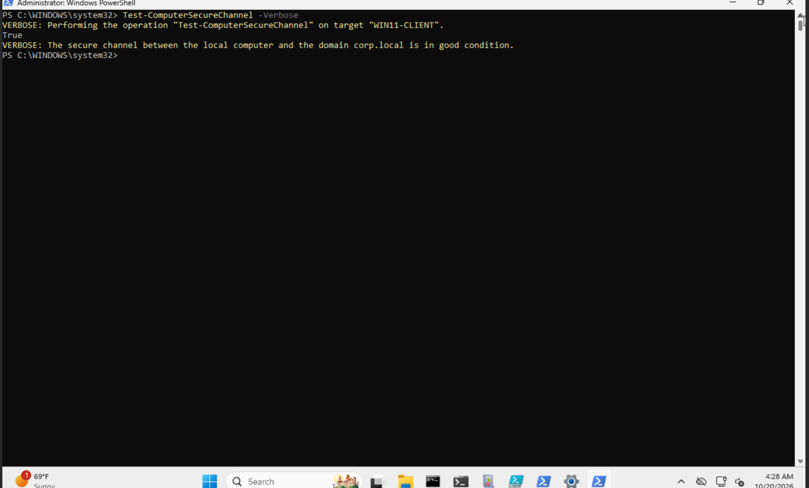

# Day 04 | DNS and Domain Functionality

**Program:** 90 Days of SOC Tier 1 & Tier 2 Mastery  
**Phase:** 01 | Active Directory & Help Desk  
**Lab:** CORP Home Lab  
**Date:** November 6, 2026  
**Status:** Hands-on verification completed

## 1. Project Overview

Day 04 continued the Active Directory investigation established during Day 03.

On Day 03, I verified the domain controller's core services, DNS records, domain controller discovery, and targeted diagnostics directly on DC01.

Day 04 moved the investigation to the Windows 11 workstation.

The objective was to determine whether the client was correctly configured to use the domain controller, could resolve its hostname, could discover the domain controller, and had a functioning domain secure channel.

This provided a new perspective on the same CORP environment rather than repeating the server-side checks.

## 2. Lab Environment

| Component | Configuration |
|---|---|
| Hypervisor | Proxmox VE |
| Domain | corp.local |
| Domain Controller | DC01 |
| Domain Controller IP | 10.10.10.10 |
| Domain Controller OS | Windows Server 2022 |
| Workstation | WIN11-CLIENT |
| Workstation OS | Windows 11 |
| Workstation IP | 10.10.10.20 |
| Subnet | 255.255.255.0 |
| Default Gateway | 10.10.10.1 |
| Workstation DNS Server | 10.10.10.10 |
| Investigation Interface | Windows PowerShell |

All four successful Day 04 verification commands were executed on WIN11-CLIENT.

## 3. Investigation Objectives

1. Verify the Windows 11 network configuration.
2. Confirm that the workstation uses DC01 as its DNS server.
3. Validate DNS hostname resolution from the workstation.
4. Verify domain controller discovery from Windows 11.
5. Test the workstation's domain secure channel.
6. Compare the findings with the Day 03 domain controller baseline.
7. Record what the evidence proves and what remains untested.

## 4. Investigation Methodology

The investigation followed a read-only verification process.

The workstation was examined before any changes were considered.

Each result was compared with the expected CORP network configuration and the verified Day 03 baseline.

No DNS settings, domain memberships, or secure-channel configurations were intentionally modified.

## 5. Step 1: Verify Workstation Network Configuration

### Command

```powershell
ipconfig /all
```

### Observed Results

| Property | Actual Value |
|---|---|
| Hostname | win11-client |
| Primary DNS Suffix | corp.local |
| IPv4 Address | 10.10.10.20 |
| Subnet Mask | 255.255.255.0 |
| Default Gateway | 10.10.10.1 |
| DNS Server | 10.10.10.10 |
| DHCP | Disabled |

### Analyst Interpretation

The workstation's network configuration matched the planned CORP lab addressing scheme.

The DNS server was configured as `10.10.10.10`, the IPv4 address of DC01.

This established that the workstation was configured to use the domain controller for DNS resolution.

It did not independently prove that DNS queries or domain authentication would succeed.

### Evidence



## 6. Step 2: Verify DNS Hostname Resolution

### Command

```powershell
Resolve-DnsName dc01.corp.local
```

### Observed Results

| Property | Actual Value |
|---|---|
| Queried Hostname | dc01.corp.local |
| Record Type | A |
| Returned IPv4 | 10.10.10.10 |
| TTL | 3600 seconds |
| Command Result | Successful |

### Analyst Interpretation

The Windows 11 workstation successfully resolved the domain controller's hostname to the expected IPv4 address.

This extended the Day 03 DNS baseline from the domain controller to a separate domain workstation.

The successful DNS response did not independently prove that the workstation could authenticate to the domain.

### Evidence



## 7. Step 3: Verify Domain Controller Discovery

### Command

```powershell
nltest /dsgetdc:corp.local
```

### Observed Results

| Property | Actual Value |
|---|---|
| Domain Controller | dc01.corp.local |
| Domain Controller Address | 10.10.10.10 |
| Domain | corp.local |
| Forest | corp.local |
| AD Site | Default-First-Site-Name |
| Command Result | Completed successfully |

The output advertised domain controller capabilities including:

- PDC
- GC
- DS
- LDAP
- KDC
- TIMESERV
- WRITABLE
- DNS_DC
- DNS_DOMAIN
- DNS_FOREST

### Analyst Interpretation

Windows 11 successfully discovered DC01 as the domain controller for `corp.local`.

This demonstrated that client-side domain controller discovery was functioning during the test.

The advertised capabilities identified services associated with the discovered controller. They were not treated as independent proof of successful user authentication.

### Evidence



## 8. Step 4: Verify the Workstation Domain Secure Channel

### Command

```powershell
Test-ComputerSecureChannel -Verbose
```

### Actual Output

```text
VERBOSE: Performing the operation "Test-ComputerSecureChannel" on target "WIN11-CLIENT".
True
VERBOSE: The secure channel between the local computer and the domain corp.local is in good condition.
```

### Analyst Interpretation

The command returned `True` and explicitly reported that the workstation's secure channel with `corp.local` was in good condition.

This provided direct evidence that WIN11-CLIENT's domain secure channel passed verification at the time of testing.

The result was particularly relevant because Day 03 recorded a different secure-channel verification command returning error 1355 when executed on DC01.

The successful workstation result did not establish the cause of that earlier error or prove that the error had been resolved.

### Evidence



## 9. Connection to Day 03

Day 03 established the server-side baseline.

The verified findings included:

- DNS and NTDS services running.
- DC01 hostname resolution succeeding.
- LDAP SRV records resolving.
- Domain controller discovery succeeding.
- Netlogon and KDC services running.
- Connectivity and Advertising diagnostics passing.
- DNS diagnostics passing.

Day 03 also recorded:

```text
I_NetLogonControl failed: Status = 1355 0x54b ERROR_NO_SUCH_DOMAIN
```

This occurred when `nltest /sc_verify:corp.local` was executed on DC01.

Day 04 extended verification to WIN11-CLIENT.

The workstation successfully resolved DC01, discovered the domain controller, and passed its own secure-channel verification.

These results supported the functioning of the tested client-side domain dependencies.

They did not conclusively explain the Day 03 error.

## 10. SOC Analyst Investigation Framework

### What Did I Observe?

The Windows 11 workstation had the expected network configuration.

DNS hostname resolution and domain controller discovery succeeded.

The workstation's domain secure channel passed verification.

### What Did I Investigate, and Why?

I examined client-side DNS and domain functionality to extend the Day 03 server-side baseline.

The checks progressed from configuration to name resolution, domain controller discovery, and secure-channel verification.

Each step tested a different dependency.

### What Did I Conclude?

The collected evidence supported successful client-side DNS resolution, domain controller discovery, and domain secure-channel verification.

The findings did not establish complete authentication or Group Policy functionality.

### What Should Happen Next?

Preserve the successful Day 04 baseline for future identity and authentication exercises.

Continue the approved Active Directory learning sequence.

Investigate future authentication failures using the baseline rather than assuming DNS or domain trust is responsible.

Retain the Day 03 error 1355 as an unresolved historical finding.

## 11. Verification Summary

| Check | Result |
|---|---|
| Windows 11 IP Configuration | Matched planned lab configuration |
| DNS Server Configuration | DC01 configured |
| DNS Hostname Resolution | Successful |
| Domain Controller Discovery | Successful |
| Domain Secure Channel | Healthy |
| Configuration Changes | None intentionally performed |

## 12. Evidence Gaps and Limitations

The following were not independently verified during Day 04:

- A fresh interactive domain user authentication.
- Kerberos ticket issuance.
- Group Policy processing.
- File share access.
- Domain authentication under failure conditions.
- The precise cause of Day 03's secure-channel error 1355.

These are untested or unresolved areas, not confirmed failures.

## 13. Final Assessment

**Investigation Type:** Planned infrastructure verification

**Finding:** WIN11-CLIENT successfully resolved and discovered DC01 and passed domain secure-channel verification.

**Security Incident:** Not established

**Configuration Changes:** None intentionally performed

**Disposition:** Planned Day 04 verification completed successfully within the defined scope.

The Day 03 diagnostic discrepancy remains documented separately.

## 14. Lessons Learned

1. Domain controller health and client-side domain functionality are related but distinct verification perspectives.
2. Correct DNS configuration does not automatically prove successful DNS resolution.
3. Successful hostname resolution does not independently prove domain controller discovery.
4. Domain controller discovery does not independently prove a healthy workstation secure channel.
5. Each diagnostic result must be interpreted within the scope of its test.
6. A successful follow-up test does not automatically explain an earlier failure.
7. Connected lab projects should progressively validate new capabilities without unnecessarily repeating completed exercises.

## 15. Next Project

**Day 05 | Forests, Domains & Organizational Units**

The next exercise will build on the established CORP domain baseline by examining Active Directory's logical structure and the relationship between domains, organizational units, and identity administration.

The existing environment will be reused.

## References

- Microsoft Learn: Resolve-DnsName
  https://learn.microsoft.com/en-us/powershell/module/dnsclient/resolve-dnsname

- Microsoft Learn: Test-ComputerSecureChannel
  https://learn.microsoft.com/en-us/powershell/module/microsoft.powershell.management/test-computersecurechannel

- Microsoft Learn: nltest
  https://learn.microsoft.com/en-us/windows-server/administration/windows-commands/nltest
