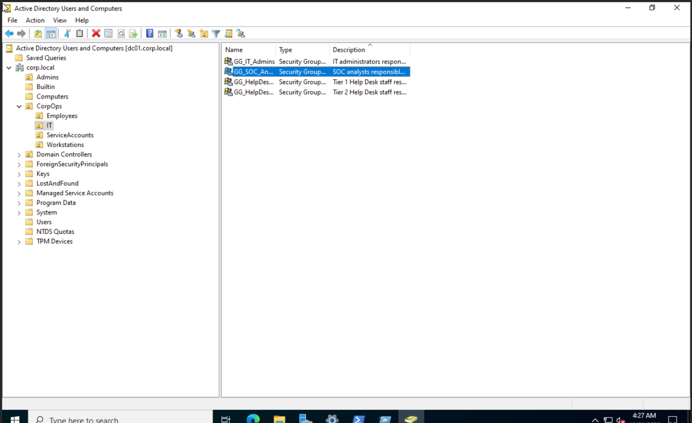
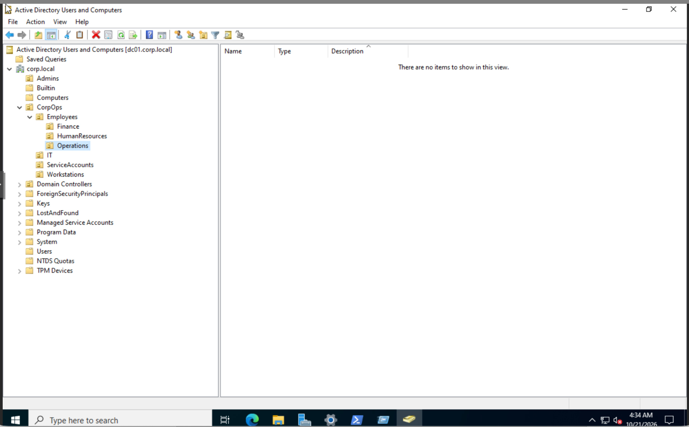
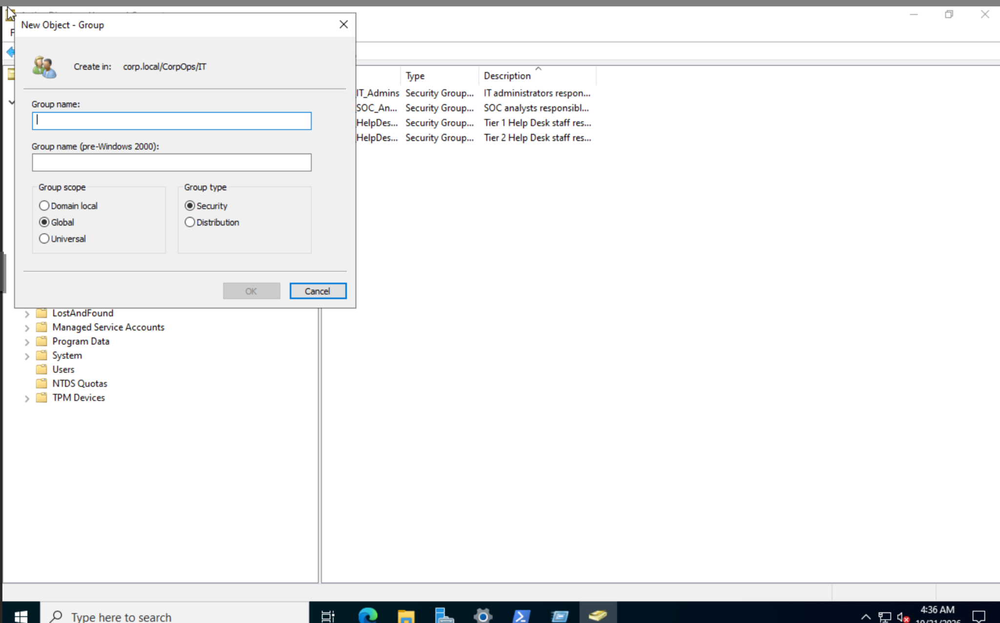
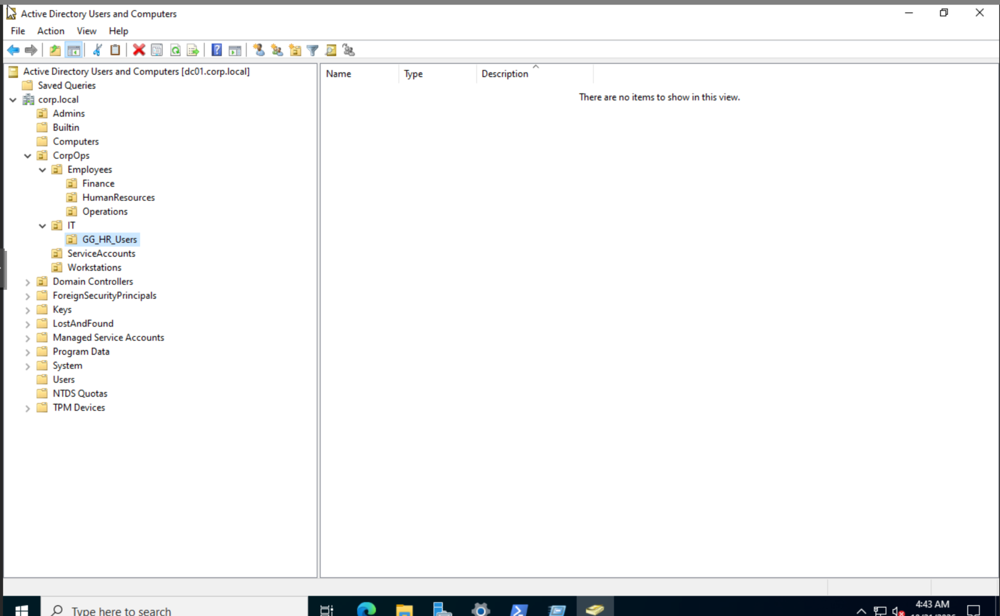
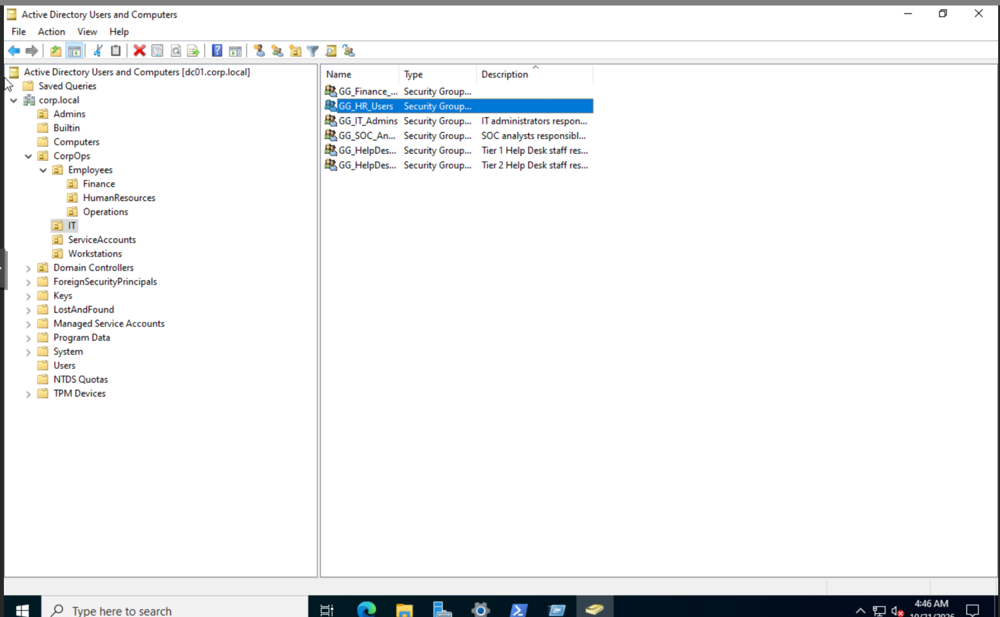
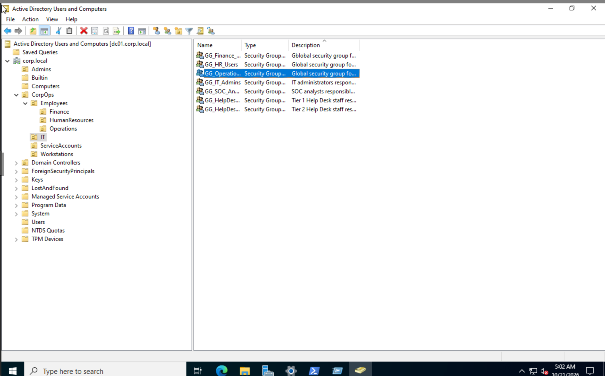
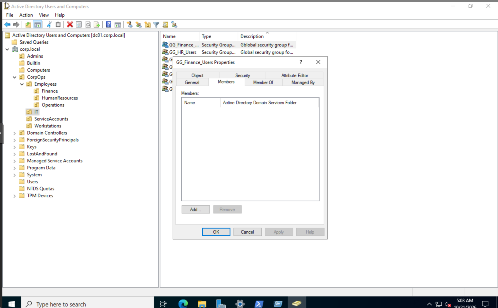

# Day 07 | Create OUs & Security Groups

**Project:** 90 Days of SOC Tier 1 & Tier 2 Mastery  
**Phase:** 01 Active Directory & Help Desk  
**Status:** Hands-on complete  
**Lab domain:** `corp.local`

## Objective

Extend the existing Active Directory structure by creating departmental Organizational Units and security groups for Finance, Human Resources, and Operations.

Verify the location, object type, group scope, and membership state of the newly created objects.

Investigate and correct an object creation mistake involving `GG_HR_Users`, while distinguishing between an object's name, its actual configuration, and its effective permissions.

## Lab Environment

| Component | Configuration |
| --- | --- |
| Hypervisor | Proxmox VE |
| Domain controller | DC01, Windows Server 2022 |
| Domain | `corp.local` |
| AD management tool | Active Directory Users and Computers (ADUC) |
| Parent OU | `corp.local/CorpOps` |
| Departmental OU location | `corp.local/CorpOps/Employees` |
| Security group location | `corp.local/CorpOps/IT` |

## Practical Work Performed

### 1. Existing Active Directory Baseline

Before making changes, I inspected the existing organizational structure and security groups.

The domain already contained:

```text
corp.local
└── CorpOps
    ├── Employees
    ├── IT
    ├── ServiceAccounts
    └── Workstations
```

Four security groups already existed in the IT OU from Day 06:

- `GG_HelpDesk_Tier1`
- `GG_HelpDesk_Tier2`
- `GG_SOC_Analysts`
- `GG_IT_Admins`

These were existing objects, not new Day 07 creations.

This baseline helped distinguish the configuration already present from the changes introduced during the exercise.

### 2. Departmental Organizational Unit Creation

Using ADUC, I created three Organizational Units under:

`corp.local/CorpOps/Employees`

| Organizational Unit | Intended Department |
| --- | --- |
| Finance | Finance employees |
| HumanResources | Human Resources employees |
| Operations | Operations employees |

During creation, the option to protect each container from accidental deletion was selected.

After creating the OUs, I inspected the directory hierarchy.

**Verified structure:**

```text
corp.local
└── CorpOps
    ├── Employees
    │   ├── Finance
    │   ├── HumanResources
    │   └── Operations
    ├── IT
    ├── ServiceAccounts
    └── Workstations
```

All three departmental OUs appeared under the intended Employees OU.

An Organizational Unit organizes directory objects and can support Group Policy targeting and delegated administration when configured.

Creating an OU does not automatically assign resource permissions.

### 3. Departmental Security Group Creation

I created security groups to represent the three departments.

The groups were placed under:

`corp.local/CorpOps/IT`

| Group | Scope | Type | Intended Role |
| --- | --- | --- | --- |
| `GG_Finance_Users` | Global | Security | Finance department users |
| `GG_HR_Users` | Global | Security | Human Resources department users |
| `GG_Operations_Users` | Global | Security | Operations department users |

The group creation dialogs were inspected to verify the selected Global scope and Security type.

The groups were intended to support future role-based access configuration.

No resource permissions were assigned during this exercise.

### 4. Human Resources Object Creation Mistake

While creating the Human Resources security group, I accidentally selected Organizational Unit instead of Group.

The intended object was:

`GG_HR_Users`

However, the initial object was created as an OU under:

`corp.local/CorpOps/IT`

The name followed the intended security group naming convention, but the actual object type was incorrect.

ADUC displayed the object with an Organizational Unit icon.

**Finding:**

An Active Directory object can have a name that suggests one purpose while its actual object class represents something different.

The `GG_` prefix did not make the incorrectly created object a Global Security group.

### 5. Correcting the Human Resources Configuration

After identifying the mistake, I returned to the correct group creation workflow.

I selected Group and configured:

- Group name: `GG_HR_Users`
- Group scope: Global
- Group type: Security
- Location: `corp.local/CorpOps/IT`

The subsequent directory inventory showed `GG_HR_Users` as a security group.

The incorrectly created OU was no longer visible beneath the IT OU.

The available screenshots establish the incorrect object, the corrected group configuration, and the later directory state.

They do not independently document every intermediate cleanup action.

### 6. Final Security Group Inventory

After completing the Finance, Human Resources, and Operations groups, I inspected the IT OU.

**Verified results:**

- Seven security groups appeared in the IT OU.
- Four groups were existing Day 06 objects.
- Three departmental groups were introduced during Day 07.
- Descriptions were added to identify the intended responsibilities of the departmental groups.

The final inventory contained:

```text
corp.local
└── CorpOps
    └── IT
        ├── GG_Finance_Users
        ├── GG_HelpDesk_Tier1
        ├── GG_HelpDesk_Tier2
        ├── GG_HR_Users
        ├── GG_IT_Admins
        ├── GG_Operations_Users
        └── GG_SOC_Analysts
```

This structure documented the intended roles but did not establish effective access permissions.

### 7. Group Membership Verification

I inspected the Members tabs of the three departmental security groups.

**Verified results:**

- `GG_Finance_Users`: No direct members observed.
- `GG_HR_Users`: No direct members observed.
- `GG_Operations_Users`: No direct members observed.

The groups existed, but no users or nested groups were shown as direct members at inspection time.

This did not establish whether the groups had permissions assigned elsewhere.

### 8. Access Design Considerations

The departmental groups could support the AGDLP access design model:

```text
Accounts
   |
   v
Global Groups
   |
   v
Domain Local Groups
   |
   v
Permissions
```

Day 07 established departmental Global Security groups.

It did not implement a complete AGDLP permission chain, configure Domain Local resource groups, or assign shared folder permissions.

## Evidence

All screenshots referenced below were captured during the actual Day 07 Active Directory home lab exercise.

### Evidence 01: Existing IT Security Groups



**Observation:** Four role-specific security groups from Day 06 were present in the IT OU before the Day 07 changes.

### Evidence 02: Departmental Organizational Units



**Observation:** Finance, HumanResources, and Operations appeared beneath the existing Employees OU.

### Evidence 03: Finance Security Group Configuration



**Observation:** The GG_Finance_Users creation dialog showed Global scope and Security type selected.

### Evidence 04: Incorrect Human Resources Object



**Observation:** GG_HR_Users was initially created as an Organizational Unit rather than a security group.

### Evidence 05: Correct Human Resources Group Configuration


**Observation:** The corrected GG_HR_Users creation dialog showed Global scope and Security type.

### Evidence 06: Human Resources Group Verification



**Observation:** GG_HR_Users appeared as a security group in the IT OU, while the incorrectly created OU was no longer visible in the inspected hierarchy.

### Evidence 07: Final Security Group Inventory



**Observation:** The IT OU contained seven security groups, including the three departmental groups created during Day 07, with populated descriptions.

### Evidence 08: Finance Group Membership Inspection



**Observation:** The GG_Finance_Users Members tab showed no direct members at inspection time.

## SOC Analyst Relevance

Active Directory object types, group memberships, and directory changes are important during identity and access investigations.

This exercise supports investigations involving:

- Unexpected Organizational Unit or security group creation.
- Incorrectly configured directory objects.
- Unauthorized security group membership changes.
- Suspicious modifications to privileged groups.
- Differences between naming conventions and actual object classes.
- Access control changes affecting departmental accounts.

The `GG_HR_Users` mistake demonstrated why analysts should verify an object's actual type instead of relying on its name.

A group name does not establish permissions, and an OU name does not establish security group membership.

A reliable investigation must distinguish the intended configuration from the observed directory state.

These are potential investigation use cases, not security incidents detected during Day 07.

## Observations and Limitations

**Observed:** Three departmental Organizational Units were created under Employees, and three Global Security groups were created under IT.

An incorrect `GG_HR_Users` Organizational Unit was identified, and the later directory state showed the correctly configured security group without the mistaken OU visible.

The final IT OU inventory contained seven security groups.

The three new departmental groups had empty direct membership lists at inspection time.

**Not yet verified:**

- Every intermediate action used to remove the incorrect HR OU.
- Security event logs recording OU or group creation.
- Historical group membership changes.
- Assigned NTFS or shared folder permissions.
- Delegated Active Directory administrative rights.
- Effective resource access.
- Group Policy application to the new OUs.
- A complete AGDLP permission chain.

The screenshots establish the inspected configuration states, not a complete historical audit trail.

These areas require separate validation during subsequent exercises.

## Outcome

Completed the departmental Organizational Unit and security group creation exercise.

Created Finance, HumanResources, and Operations OUs under Employees and three corresponding Global Security groups under IT.

Identified an incorrect `GG_HR_Users` Organizational Unit, corrected the configuration, and verified the final directory inventory.

Confirmed that the three departmental groups had no direct members in the inspected views.

**Final disposition:** Departmental OU and security group structure established. No user memberships, resource permissions, or policies assigned during Day 07.

No security incident was identified or confirmed during this exercise.

## Next Exercise

**Day 08 | Create Planned Enterprise User Accounts**

Continue the approved Active Directory learning plan by creating the planned departmental user accounts and verifying their placement and configuration, building on the existing Day 07 structure without repeating completed work.
