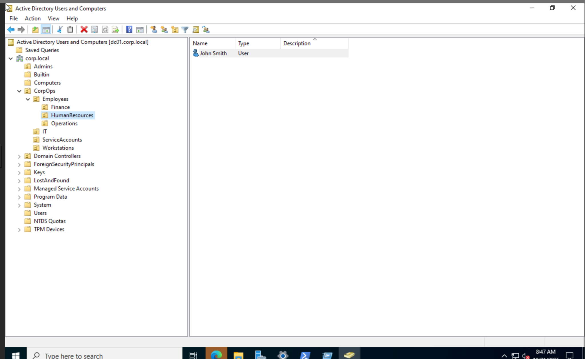
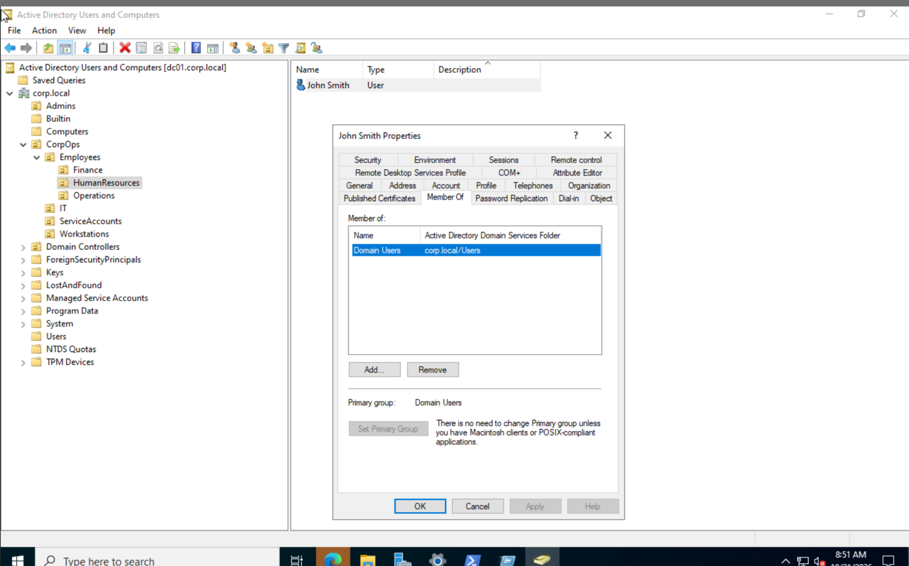
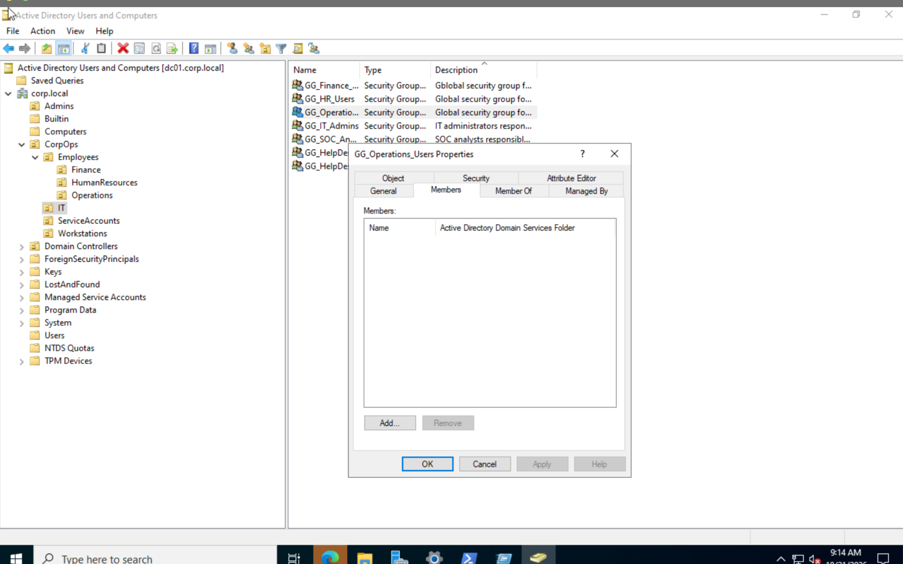
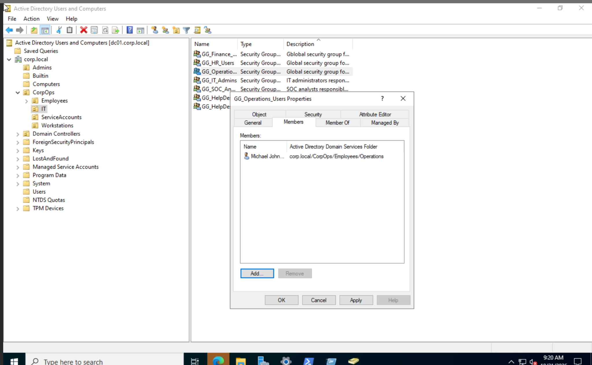
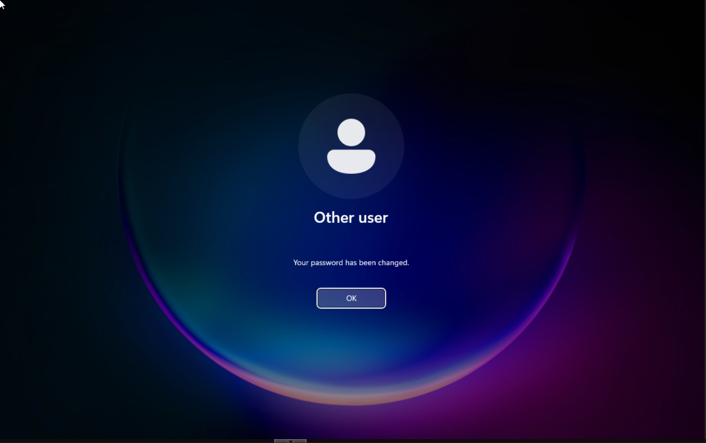
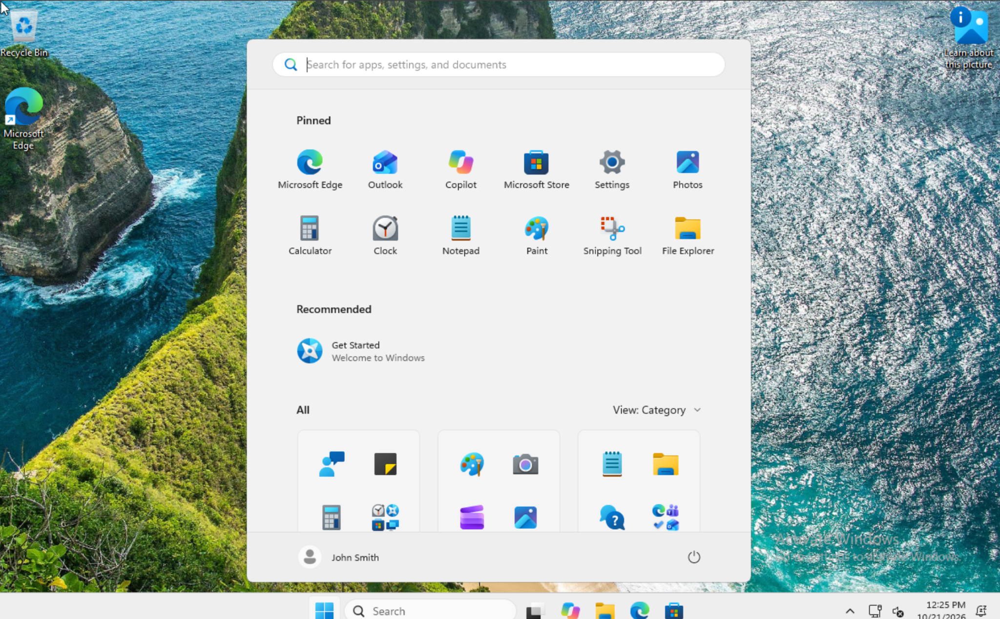
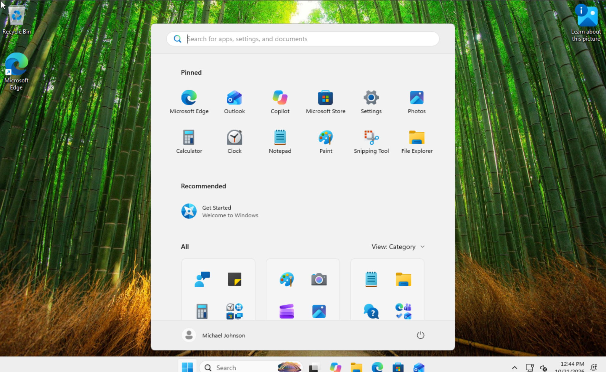
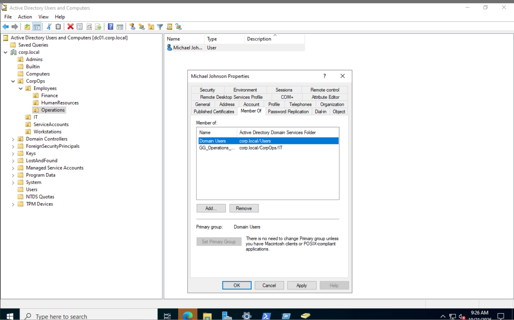

# Day 08 | Create Planned Enterprise User Accounts

**Project:** 90 Days of SOC Tier 1 & Tier 2 Mastery  
**Phase:** 01 Active Directory & Help Desk  
**Status:** Hands-on complete  
**Lab domain:** `corp.local`

## Objective

Create three planned enterprise user accounts in the existing Active Directory environment and verify their departmental placement, security group membership, and first Windows domain sign-in.

Investigate a membership discrepancy involving the Operations account and verify the final configuration.

Distinguish between account creation, successful authentication, and effective resource authorization.

## Lab Environment

| Component | Configuration |
| --- | --- |
| Hypervisor | Proxmox VE |
| Domain controller | DC01, Windows Server 2022 |
| Domain | `corp.local` |
| Client | Domain-joined Windows 11 |
| AD management tool | Active Directory Users and Computers (ADUC) |
| Departmental OUs | Finance, HumanResources, Operations |
| Group location | `corp.local/CorpOps/IT` |

## Practical Work Performed

### 1. Existing Active Directory Baseline

Before creating employee accounts, I reviewed the departmental structure established during Day 07.

The following Organizational Units already existed:

```text
corp.local
└── CorpOps
    ├── Employees
    │   ├── Finance
    │   ├── HumanResources
    │   └── Operations
    ├── IT
    ├── ServiceAccounts
    └── Workstations
```

The corresponding departmental Global Security groups were also available:

- `GG_Finance_Users`
- `GG_HR_Users`
- `GG_Operations_Users`

These objects were created during Day 07 and were not recreated during Day 08.

### 2. Enterprise User Account Creation

Using ADUC, I created three departmental employee accounts.

| Employee | Username | Department | Security Group |
| --- | --- | --- | --- |
| Sarah Mitchell | `sarah.mitchell` | Finance | `GG_Finance_Users` |
| John Smith | `jsmith` | HumanResources | `GG_HR_Users` |
| Michael Johnson | `mjohnson` | Operations | `GG_Operations_Users` |

Each account was placed in its corresponding departmental Organizational Unit.

Initial passwords were configured, and the requirement to change the password at the next logon was enabled.

The account creation process established the identities in Active Directory.

It did not independently prove that the accounts could successfully authenticate.

### 3. Departmental Security Group Membership

After creating the accounts, I inspected their group memberships.

**Verified results:**

- Sarah Mitchell appeared in `GG_Finance_Users`.
- John Smith appeared in `GG_HR_Users`.
- Michael Johnson's account properties displayed `GG_Operations_Users`.

For Sarah Mitchell, the account's Member Of tab and the Finance group's Members tab showed the expected relationship.

For John Smith, the HR membership remained visible after reopening the account properties.

Michael Johnson's membership required further investigation because two ADUC views initially disagreed.

### 4. Operations Group Membership Discrepancy

While inspecting Michael Johnson's account, I observed:

- His Member Of tab displayed `GG_Operations_Users`.
- The Operations group's Members tab initially appeared empty.

I reopened Michael's account properties and confirmed that the Operations group remained listed.

I then inspected the group's Members tab again.

The list still appeared empty.

**Initial hypothesis:** The intended membership might not have been saved consistently.

This was a working hypothesis, not a confirmed root cause.

The conflicting observations required further verification.

### 5. Correcting the Operations Membership

To resolve the discrepancy, I used the Operations group's Add Members dialog to resolve and add Michael Johnson.

After applying the change, I closed and reopened the group properties.

**Verified results:**

- Michael Johnson appeared in the `GG_Operations_Users` Members tab.
- `GG_Operations_Users` remained visible in Michael Johnson's Member Of tab.

The two inspected views now agreed.

The membership discrepancy was resolved.

However, the underlying cause of the original inconsistent views was not established.

### 6. First Domain Sign-In: Sarah Mitchell

I tested Sarah Mitchell's account on the domain-joined Windows 11 client.

Windows displayed the message:

"The user's password must be changed before signing in."

This matched the initial account configuration.

I completed the password-change process.

Windows confirmed:

"Your password has been changed."

The desktop subsequently loaded successfully.

This demonstrated the expected first-logon password-change behavior and successful interactive sign-in.

### 7. First Domain Sign-In: John Smith

I repeated the test using John Smith's domain account.

**Verified results:**

- Windows required a password change.
- The password-change process completed successfully.
- Windows confirmed that the password had been changed.
- The desktop loaded.
- The Start menu displayed John Smith.

The observed behavior was consistent with the configured first-logon password-change requirement.

### 8. First Domain Sign-In: Michael Johnson

Finally, I tested Michael Johnson's account.

This test was particularly important because his Operations group membership had required correction.

**Verified results:**

- Windows required a password change.
- The password change succeeded.
- The Windows desktop loaded.
- The Start menu displayed Michael Johnson.

All three employee accounts completed the documented first interactive domain sign-in workflow.

### 9. Authentication and Authorization

The exercise demonstrated two different concepts.

**Authentication:** Verifying that an account can successfully sign in.

**Authorization:** Determining which resources and actions the authenticated account is permitted to access.

Successful Windows sign-in did not establish that an employee could access departmental shared folders.

Likewise, membership in a departmental security group did not independently prove that resource permissions had been assigned.

No departmental shared-folder access tests were performed during Day 08.

## Evidence

The screenshots referenced below were collected during the actual Day 08 Active Directory home lab exercise.

The filenames are the selected GitHub evidence naming scheme and must be matched to the original screenshots before upload.

### Evidence 01: Departmental User Account Inventory



**Observation:** The newly created employee accounts appeared in their intended departmental Organizational Units.

### Evidence 02: Finance Group Membership



**Observation:** Sarah Mitchell's account and the Finance security group displayed the intended membership relationship.

### Evidence 03: Operations Membership Discrepancy



**Observation:** The Operations group's Members tab appeared empty even though Michael Johnson's account properties listed the group.

### Evidence 04: Corrected Operations Membership



**Observation:** Michael Johnson appeared in the Operations group's Members tab after the membership correction.

### Evidence 05: Sarah Mitchell Password Change



**Observation:** Windows confirmed that Sarah Mitchell's password had been changed during her first-logon workflow.

### Evidence 06: John Smith Successful Sign-In



**Observation:** The Windows desktop session displayed John Smith following the required password change.

### Evidence 07: Michael Johnson Successful Sign-In



**Observation:** The Windows desktop session displayed Michael Johnson following the required password change.

### Evidence 08: Final Active Directory Account Configuration



**Observation:** The final Active Directory inspection documented the configured departmental employee accounts.

## SOC Analyst Relevance

Enterprise identity investigations require more than confirming that an account exists.

This exercise supports investigations involving:

- Newly created Active Directory accounts.
- Unexpected departmental group membership.
- Inconsistent identity configuration.
- First-logon password-change activity.
- Successful and failed authentication.
- Potential unauthorized account provisioning.
- Differences between authentication and resource authorization.

The Operations membership discrepancy demonstrated why conflicting observations should be investigated rather than ignored.

A SOC analyst should distinguish between:

1. An account existing in Active Directory.
2. The account having the intended group membership.
3. The account successfully authenticating.
4. The account having permission to access a resource.

Each conclusion requires appropriate evidence.

These are potential investigation use cases, not security incidents detected during Day 08.

## Observations and Limitations

**Observed:** Three employee accounts were created in their departmental OUs, the intended security group memberships were verified, and an Operations membership discrepancy was corrected.

All three employees completed the mandatory first-logon password-change workflow and successfully reached the Windows desktop during the exercise.

**Not yet verified:**

- The underlying cause of the original Operations membership discrepancy.
- Effective NTFS permissions.
- Departmental shared-folder access.
- Delegated administrative rights.
- Windows Security authentication event correlation.
- Kerberos authentication event analysis.
- SIEM ingestion or alert validation.
- Historical audit records for account creation and membership changes.

The evidence demonstrates account configuration and observed interactive authentication behavior.

It does not establish effective authorization to departmental resources.

These areas require separate validation during subsequent exercises.

## Outcome

Completed the planned enterprise user account provisioning and first-logon verification exercise.

Created Sarah Mitchell, John Smith, and Michael Johnson in their corresponding departmental Organizational Units.

Verified the intended security group memberships, investigated and corrected the Operations membership discrepancy, and tested all three accounts on the domain-joined Windows 11 client.

Each account completed the mandatory password-change workflow and successfully reached the Windows desktop.

**Final disposition:** Three enterprise employee identities provisioned and authenticated successfully. Departmental resource access was not tested.

No security incident was identified or confirmed during this exercise.

## Next Exercise

**Day 09 | Failed and Successful Logon Investigation**

Continue the approved Active Directory learning plan by investigating Windows authentication events, distinguishing failed from successful sign-ins, and correlating the observed event details with controlled authentication activity.
